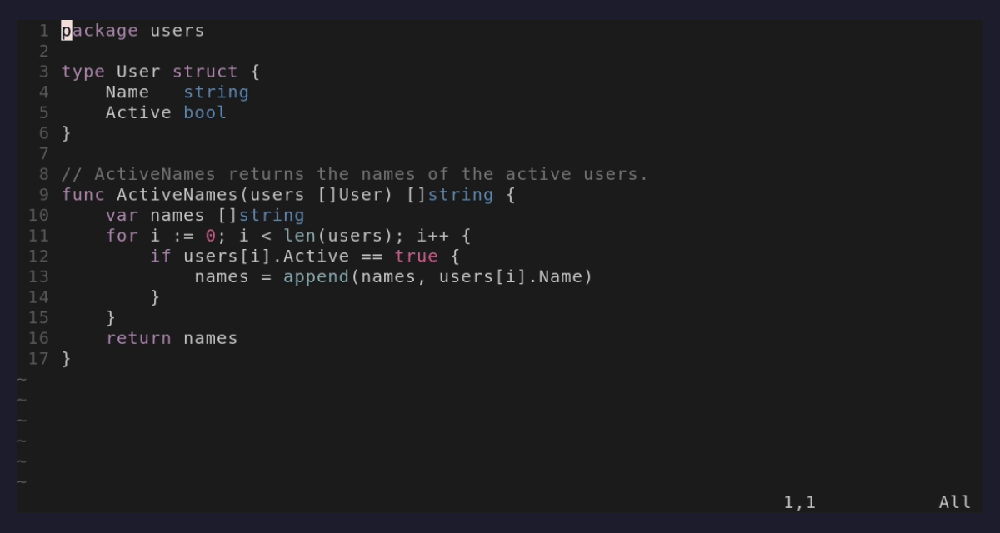

# herald.nvim

Run [Claude Code](https://docs.anthropic.com/en/docs/claude-code) from Neovim. Select code and describe a change to have it rewritten in place. Ask a question about the project and get the answers in the quickfix list. Hand off a multi-step task and read the summary in a split.



Herald is named after the Heralds of Galactus, who go out and do work on behalf of something much larger. Herald sends your request to the `claude` CLI and brings the result back into the buffer.

- [Requirements](#requirements)
- [Quick start](#quick-start)
- [Examples](#examples)
- [Configuration](#configuration)
- [Commands and Lua API](#commands-and-lua-api)
- [How it works](#how-it-works)
- [Development](#development)

## Requirements

- Neovim 0.10 or later.
- The [Claude Code CLI](https://docs.anthropic.com/en/docs/claude-code) on your `PATH`, logged in. Run `claude` once in a terminal to log in.
- Optional: [fidget.nvim](https://github.com/j-hui/fidget.nvim) for a progress spinner during search and agent tasks.

Run `:checkhealth herald` to check all of these.

## Quick start

In this section we install Herald, rewrite a loop, search the project, and run an agent task.

### Install

With [lazy.nvim](https://github.com/folke/lazy.nvim):

```lua
{
  "callrua/herald.nvim",
  dependencies = { "j-hui/fidget.nvim" }, -- optional
  config = function()
    local herald = require("herald")
    herald.setup({ model = "sonnet" })

    vim.keymap.set("v", "<leader>hv", herald.visual, { desc = "Herald: rewrite selection" })
    vim.keymap.set("n", "<leader>hs", herald.search, { desc = "Herald: search" })
    vim.keymap.set("n", "<leader>ha", herald.agent, { desc = "Herald: agent task" })
    vim.keymap.set("n", "<leader>hx", herald.stop, { desc = "Herald: stop" })
  end,
}
```

Restart Neovim, then run `:checkhealth herald`. Every line should say OK, except the fidget line if you skipped it.

### Submit a prompt

Every operation opens the same floating prompt window in insert mode. Type your prompt, then:

1. Press `<Esc>` to go to normal mode.
2. Press `w` to submit, or `q` to cancel.

`w` is not `:w`. The window title shows `(w submit, q cancel)` as a reminder. Because `w` submits, the `w` word motion does not work in the prompt window. Use `e`, `b`, or `W` instead.

### Rewrite a selection

1. Open a Lua file and select a few lines with `V`.
2. Press `<leader>hv`. The prompt window opens.
3. Type `add a comment above each line explaining it`, press `<Esc>`, then `w`.

A `⠋ herald` spinner appears above the selection. When Claude replies, the selected lines are replaced and Herald shows `Herald: replaced N lines ($0.0xxx)`. Press `u` to undo the change.

### Search the project

1. Press `<leader>hs`.
2. Type `where is the config loaded`, press `<Esc>`, then `w`.

The quickfix window opens with one entry per location and a note on why each one matches. Press `<CR>` on an entry to jump to it.

### Run an agent task

1. Press `<leader>ha`.
2. Type `add a docstring to every public function in this file`, press `<Esc>`, then `w`.

The agent reads and edits files on its own. When it finishes, a vertical split opens with its summary and Herald shows the duration and cost. Run `:checktime` to reload buffers the agent changed.

## Examples

Each example gives the prompt and what happens. Model output varies, so treat the results as typical rather than exact.

### Rewrite a loop with `vim.tbl_map`

Select these lines with `V`:

```lua
local names = {}
for _, item in ipairs(items) do
  table.insert(names, item.name)
end
```

Press `<leader>hv` and submit `use vim.tbl_map`. The selection becomes:

```lua
local names = vim.tbl_map(function(item)
  return item.name
end, items)
```

Press `u` to restore the loop. Herald replaces whole lines, even when you start from a characterwise selection. You can keep editing elsewhere in the buffer while the request runs. Herald tracks the selection with extmarks, so the reply lands on the right lines.

### Find where sessions are saved

In this repository, press `<leader>hs` and submit `where are sessions persisted`. The quickfix list fills with entries like these:

```
lua/herald/session.lua|22 col 1| Builds the path to sessions.json under stdpath("data")
lua/herald/session.lua|110 col 1| save() writes the session state as JSON
lua/herald/init.lua|13 col 3| Saves sessions on VimLeavePre
```

Search is read-only. Claude can use `Read`, `grep`, `find`, `rg`, `git`, and `ls`, and nothing else.

### Add a test with the agent

Press `<leader>ha` and submit:

```
add a test to test/test_parse.lua for a search_locations line with empty notes
```

Or skip the prompt window and pass the task inline:

```vim
:HeraldAgent add a test to test/test_parse.lua for a search_locations line with empty notes
```

The agent edits `test/test_parse.lua`, a split opens with its summary, and Herald shows `Herald: agent complete in 38.4s ($0.0712)`. Run `:HeraldStop` to cancel a task that runs too long.

### Continue a conversation with sessions

Search and agent requests share one Claude session, so a follow-up can refer to the last answer:

1. Run a search: `where are sessions persisted`.
2. Run an agent task: `move that path into config.lua as a data_dir option`.
3. Run `:HeraldSession data-dir-refactor` to name the session.
4. Run `:HeraldNewSession` to start fresh for unrelated work.
5. Later, run `:HeraldResume`, pick `data-dir-refactor (2h ago)`, and carry on.

Run `:HeraldSessionInfo` to see the current session's name, ID, and creation date. Visual replace never uses or changes the session.

### Pull in a rule and a file

Point Herald at a directory of rules:

```lua
require("herald").setup({
  completion = {
    global_rules = { "~/.config/herald/rules" },
  },
})
```

Each rule is a directory with a `SKILL.md` inside, for example `~/.config/herald/rules/lua-style/SKILL.md`. In the prompt window, type `#` to complete rule names and `@` to complete project files:

```
#lua-style rewrite this to match @lua/herald/config.lua
```

Herald removes `#lua-style` and `@lua/herald/config.lua` from the prompt text. It appends the rule's `SKILL.md` and the file's contents to the prompt.

## Configuration

Pass any of these to `setup()`. The values shown are the defaults.

```lua
require("herald").setup({
  model = "sonnet",
  effort = nil,
  permission_mode = "auto",
  max_budget_usd = nil,
  md_files = { "AGENT.md", "CLAUDE.md" },
  system_prompt = nil,
  visual = {
    bare = false,
  },
  completion = {
    custom_rules = {},
    global_rules = {},
    files = { enabled = true },
  },
})
```

| Option | Type | Default | Effect |
|---|---|---|---|
| `model` | `string` | `"sonnet"` | Passed to `claude --model`. Takes an alias (`sonnet`, `opus`, `haiku`) or a full model name. |
| `effort` | `string\|nil` | `nil` | Passed to `claude --effort`: `low`, `medium`, `high`, `xhigh`, or `max`. `nil` uses the CLI default. |
| `permission_mode` | `string` | `"auto"` | Passed to `claude --permission-mode` for agent tasks only: `acceptEdits`, `auto`, `bypassPermissions`, `manual`, `dontAsk`, or `plan`. The agent runs non-interactively and cannot ask you to approve a tool. |
| `max_budget_usd` | `number\|nil` | `nil` | Passed to `claude --max-budget-usd` on every request. The CLI stops the request when it reaches this amount. |
| `md_files` | `string[]` | `{ "AGENT.md", "CLAUDE.md" }` | File names to collect from the current file's directory and each parent up to Neovim's working directory. Herald appends their contents to the system prompt. |
| `system_prompt` | `string\|nil` | `nil` | Text appended after Herald's own instructions for each operation, through `claude --append-system-prompt`. |
| `visual.bare` | `boolean` | `false` | Adds `claude --bare` to visual replace. Bare mode skips hooks, plugins, and `CLAUDE.md` discovery, so replies come back sooner. It accepts only `ANTHROPIC_API_KEY` authentication and ignores a Claude subscription login. |
| `completion.custom_rules` | `string[]` | `{}` | Project rule directories. Herald looks for `<dir>/<name>/SKILL.md`. A project rule overrides a global rule with the same name. |
| `completion.global_rules` | `string[]` | `{}` | Global rule directories, in the same layout. |
| `completion.files.enabled` | `boolean` | `true` | Opens file completion when you type `@` in the prompt window. Set to `false` to type `@` without a popup. `@path` references still resolve. |

## Commands and Lua API

| Command | Lua | Effect |
|---|---|---|
| (visual mode keymap) | `require("herald").visual()` | Opens the prompt and rewrites the selected lines. |
| `:HeraldSearch` | `require("herald").search()` | Opens the prompt, searches the project, and fills the quickfix list. |
| `:HeraldAgent [task]` | `require("herald").agent()` | Opens the prompt, or runs `task` directly, and shows the agent's summary in a split. |
| `:HeraldStop` | `require("herald").stop()` | Cancels every request in flight. |
| `:HeraldNewSession` | `require("herald").new_session()` | Clears the current session. The next search or agent request starts a new one. |
| `:HeraldSession <name>` | `require("herald").name_session(name)` | Names the current session. |
| `:HeraldResume` | `require("herald").resume_session()` | Opens a `vim.ui.select` picker of saved sessions, most recent first. `*` marks the current one. |
| `:HeraldSessionInfo` | `require("herald").session_info()` | Shows the current session's name, ID, and creation date. |

## How it works

Each operation runs `claude --print --output-format json` with `vim.system`, so Neovim stays responsive. Several requests can run at once.

| Operation | Context sent | Tools | Session | Result |
|---|---|---|---|---|
| Visual replace | The selection, 50 lines either side, and the file path | None | Not used | Replaces the selected lines |
| Search | The prompt | `Read` and `Bash` limited to `grep`, `find`, `rg`, `git`, and `ls` | Resumed | Quickfix list |
| Agent | The prompt | All, under `permission_mode` | Resumed | Summary in a vertical split |

**Search output format.** Herald tells Claude to reply only with lines in the form `/abs/path:LINE:COL,COUNT,NOTES` and drops every other line. If no line matches, Herald shows the first 500 characters of the raw reply instead of opening quickfix. That usually means the model answered in prose. Rephrase the prompt as a question about where something is.

**Sessions.** After each search or agent request, Herald stores the session ID that `claude` returns and passes it back with `--resume` next time. Herald saves sessions to `stdpath("data")/herald/sessions.json`, which is `~/.local/share/nvim/herald/sessions.json` on Linux. It saves after each request and again when Neovim exits, so `:HeraldResume` works across restarts.

**Rules and files.** `#name` resolves to the first `<dir>/name/SKILL.md` found, checking `completion.custom_rules` before `completion.global_rules`. `@path` reads the file relative to Neovim's working directory, or from an absolute path. If a rule or file does not exist, Herald leaves the token in the prompt unchanged.

## Development

Run the offline tests:

```sh
make test
```

`test/test_cli.lua` and `test/test_resume.lua` call the real `claude` CLI, so they cost money and stay out of `make test` and CI. Run one by hand with:

```sh
nvim --headless -u NONE --cmd "set rtp+=." -c "luafile test/test_cli.lua" -c "qa!"
```

The demo at the top of this README comes from `assets/demo.tape`. To record it again, install [VHS](https://github.com/charmbracelet/vhs) and run `make demo`. The recording makes a real `claude` request.

## License

[MIT](LICENSE)
